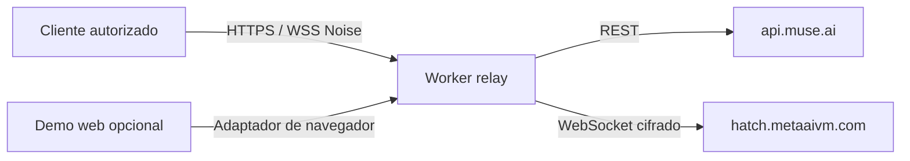
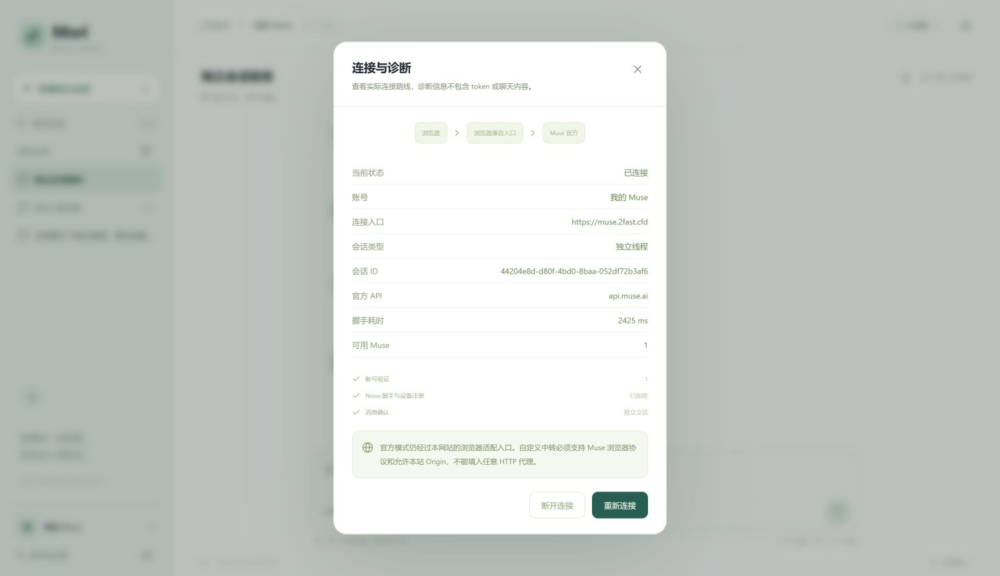
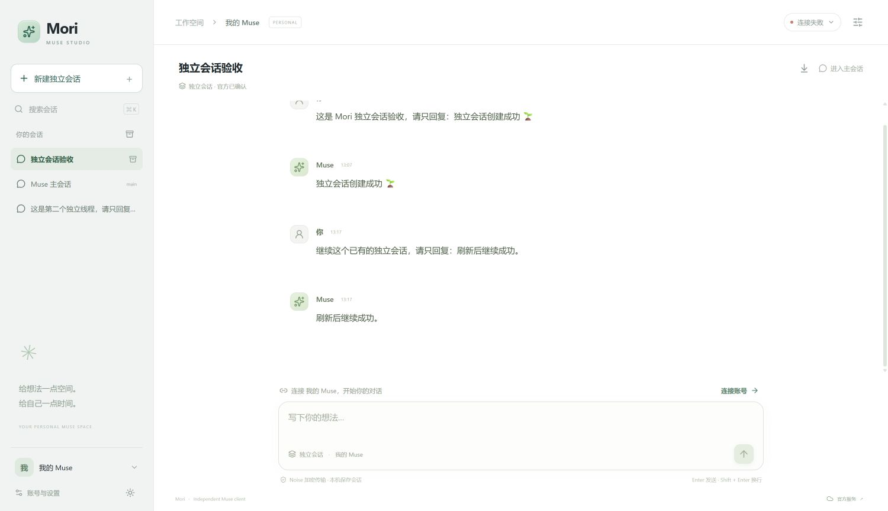

# Mori · Relay de Muse en Cloudflare Workers

[English](README.md) · [繁體中文](README.zh-TW.md)

El producto principal es el **relay de Cloudflare Workers** para las API de cuenta de Muse y conexiones WebSocket cifradas con Noise. Mori Studio es un cliente React opcional, servido por el mismo Worker. Es un proyecto comunitario independiente de Meta.

## Qué se despliega y para qué sirve

Despliegas un único origen HTTPS/WSS configurable para clientes Muse autorizados. El Worker reenvía tanto las API de cuenta como el transporte cifrado de la VM a los servicios oficiales. Permite usar tu dominio y una ruta de red alternativa; cualquier mejora de latencia o disponibilidad debe medirse en la red real del cliente.

**La opción predeterminada es solamente el Worker.** No necesitas React, ESP32, VPS, servidor Python, base de datos ni un PC encendido. La cuenta, la VM y la IA siguen en Muse. La página opcional es un cliente de prueba del protocolo.



Guías detalladas: [arquitectura y secuencia](docs/ARCHITECTURE.md), [despliegue y diagnóstico](docs/DEPLOYMENT.md), [capturas y evidencia](docs/SCREENSHOTS.md). Estas guías técnicas están en inglés; también hay una [guía completa en chino simplificado](docs/GUIDE.zh-CN.md).

Para usar el relay, configura **el host de cuenta y el de Noise**, añade la clave del relay y conserva las credenciales oficiales adecuadas. La API de cuenta devuelve un token de VM; después el cliente abre WebSocket, completa Noise, se registra y procesa las tramas de chat. No es una API pública que acepte texto mediante un POST a `/chat/stream`.


## Organización

- `main`: relay independiente del hardware, pruebas y documentación.
- `relay/`: implementación, configuraciones de despliegue y pruebas de contrato.
- `studio/`: aplicación React + TypeScript opcional, sin servidor de aplicación.
- [`test/esp32-spotpear`](https://github.com/tianrking/muse-workers-relay/tree/test/esp32-spotpear): implementación completa de ESP32, adaptación Spotpear V1, herramientas y pruebas de hardware. Conserva el estado anterior a la separación. Los commits antiguos permanecen en el historial compartido.

## Funcionamiento

El cliente conecta con tu Worker mediante HTTPS/WebSocket. El Worker reenvía a destinos oficiales fijos: `api.muse.ai` para cuentas y `hatch.metaaivm.com` para Noise. Conserva cuerpos y estados HTTP del servidor y devuelve la actualización WebSocket. No descifra las tramas Noise ni interpreta conversaciones o audio.

La clave compartida del relay protege las rutas nativas/personalizadas; cada usuario necesita además sus propias credenciales válidas de Muse. Cloudflare termina TLS y puede ver las cabeceras de autorización. Las rutas de navegador adaptan la autenticación WebSocket y validan Origin; esa comprobación no sustituye la autenticación del usuario.

## Desplegar solamente el relay

Requisitos: Node.js 22.18+ y pnpm. Desde la raíz:

```sh
cd relay
pnpm install --frozen-lockfile
cp wrangler.example.jsonc wrangler.local.jsonc
pnpm exec wrangler login
pnpm exec wrangler deploy --config wrangler.local.jsonc
pnpm exec wrangler secret put MUSE_RELAY_KEY --config wrangler.local.jsonc
```

En PowerShell usa `Copy-Item` en lugar de `cp`. Cambia el nombre del Worker en la copia antes de desplegar. Introduce una clave aleatoria propia y configura la misma en los clientes nativos. Hasta configurar el secreto, el Worker devuelve 503. La configuración local y `.dev.vars` se excluyen de Git.

Comprueba `https://<tu-worker>/health`; este endpoint no demuestra que una cuenta esté autorizada ni que una conversación funcione. Puedes añadir un dominio propio desde Cloudflare.

## Incluir el cliente web opcional

Desde la raíz, ejecuta `cd studio`, `pnpm install --frozen-lockfile` y `pnpm build`. Después, en `relay/`, instala dependencias y copia `wrangler.web.example.jsonc` a `wrangler.local.jsonc`. Configura tu nombre y despliega con los comandos anteriores. Esta variante sirve `studio/dist`.

El navegador usa por defecto las rutas del mismo origen, sin pedir la clave compartida del relay ni incluirla en JavaScript. Para otros sitios, configura `BROWSER_ORIGINS` como una cadena JSON con orígenes exactos. El despliegue personal existente es [muse.2fast.cfd](https://muse.2fast.cfd); quien lo aloje por su cuenta utiliza su propio dominio.

Studio ofrece perfiles de cuenta, selección de Muse, conversaciones independientes con UUID, selección explícita de la conversación principal, respuestas Markdown en streaming, servidores personalizados y almacenamiento local cifrado opcional. Consulta la [documentación de Studio](studio/README.zh-CN.md).

## Contrato y credenciales

| Ruta | Autenticación |
| --- | --- |
| `GET /health` | Pública una vez configurado el secreto |
| `GET /fetch_vms` | Bearer de Muse + `X-Muse-Relay-Key` |
| `POST /device_token/mint` | Bearer apropiado de Muse + clave del relay |
| `POST /device_token/refresh` | Bearer de renovación + clave del relay |
| `WS /v1/noise?vm_id=…` | Token de VM + clave del relay |
| `GET /web/account`, `POST /web/refresh` | Bearer correspondiente + Origin permitido |
| `WS /web/official-noise?vm_id=…` | Token de VM en subprotocolo + Origin permitido |
| `WS /web/noise?vm_id=…` | Token de VM y clave del relay en subprotocolo + Origin permitido |

El navegador envía `muse-v1` y `muse-auth.` seguido de JSON codificado en base64url: `{"token":"<vm_auth_token>","key":"<relay_key>"}`. La ruta del adaptador del mismo origen no necesita `key`. El Worker convierte el token en cabecera oficial y no reenvía el subprotocolo secreto. No pongas tokens en la URL.

Un SDK token corto `mgst_…` no permite chatear por sí solo. Las credenciales de dispositivo se obtienen mediante el emparejamiento oficial con la aplicación Muse; después la API de cuenta proporciona el token de VM. Studio admite credenciales de ESP32 y Linux. No sustituimos el inicio de sesión oficial ni el emparejamiento. Los clientes sin modificar pueden necesitar configurar cabeceras y endpoints adicionales.

## Verificación y límites

En `relay/`: `pnpm test` y `pnpm exec wrangler deploy --dry-run --config wrangler.example.jsonc`. En `studio/`: `pnpm test` y `pnpm build`. Hay 16 pruebas de contrato del Worker y 9 del cliente. Las pruebas simuladas no sustituyen la validación del servicio desplegado.

Las pruebas reales anteriores en PC completaron consulta de cuenta, WebSocket 101, handshake Noise y respuestas de texto a través del relay. La rama de hardware conserva la conexión de Spotpear mediante un hotspot ordinario del usuario. El audio no está completamente validado. Esta reorganización no despliega cambios en producción.

El cliente debe poder acceder a Cloudflare y Muse debe aceptar el tráfico saliente. No se garantiza la misma disponibilidad o latencia en todos los países. No se guardan credenciales ni se cachean respuestas de cuenta. Los ejemplos desactivan observabilidad; no incluyen cuotas por usuario. Revisa tu plan y los controles de acceso antes de compartir un servicio.

## Despliegue desde el panel y comprobación

También puedes crear un Worker en el panel de Cloudflare y pegar **todo** `relay/worker.template.mjs` en su editor. En Settings → Variables and Secrets añade `MUSE_RELAY_KEY` como Secret y guarda/despliega. Esto no sube el cliente React. Para un dominio propio, usa Settings → Domains & Routes → Add → Custom Domain en una zona activa tuya; Cloudflare configura DNS y certificado.

Comprueba por separado: `/health` 200 → `/fetch_vms` 200 con credenciales propias → WebSocket 101 con token de VM → Noise y registro → respuesta a un mensaje nuevo. El relay sin assets no tiene página de inicio: un 401/404 en `/` es normal. Un 503 indica secreto ausente; un 401 puede ser clave del relay o autorización oficial; 426 indica falta de Upgrade y 502 fallo al conectar con el upstream.

Quitar los assets no elimina las rutas de adaptador de navegador sin clave compartida. Origin no es autenticación privada; si quieres restringir todo el tráfico a invitados, necesitas una política de acceso compatible o desactivar esos adaptadores. Consulta los [límites de confianza](docs/ARCHITECTURE.md).

## Demo opcional: capturas históricas



Captura del 2026-10-15: muestra origen del relay, cuenta, Noise y registro conectados en ese momento. Los 2425 ms son una muestra, no un benchmark mundial.



La captura de chat muestra respuestas anteriores y continuación tras recargar, pero la esquina superior derecha indica **conexión fallida**. Es historial local conservado después de desconectarse; no demuestra conexión activa al capturar. [Inicio](studio/docs/studio-home.png) y [guía Linux](studio/docs/linux-onboarding.png) solo muestran la interfaz. Consulta [evidencia y límites](docs/SCREENSHOTS.md).

## Licencia

Consulta [LICENSE](LICENSE), los avisos de cada archivo y el [SDK oficial](https://github.com/facebookincubator/muse-gadget-sdk). La rama ESP32 conserva las licencias originales. Nunca subas tokens, secretos ni claves de firma de producción.
