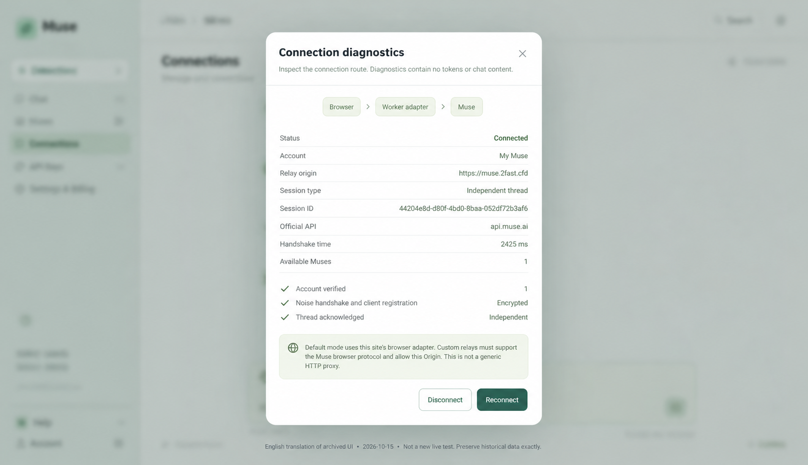

# Mori · Muse Workers Relay

[Español](README.es.md) · [繁體中文](README.zh-TW.md)

A Cloudflare Workers relay for authenticated Muse account APIs and encrypted Noise WebSocket connections. **The Worker is the core product.** Mori Studio is an optional React browser client served by the same Worker. This is an independent community project, not an official Meta service.

## What you deploy and why

Deploy one configurable HTTPS/WSS origin for authorized Muse gadgets and custom clients. The relay forwards the account API and the encrypted VM transport to the official services, so both paths can use your own domain. It can offer an alternative network route; any speed or reachability improvement must be measured on the client's actual network.

**Default deployment: just the Worker.** No React build, ESP32, VPS, Python server, database or always-on PC is required. The AI, account authorization and VM still run at Muse. The optional webpage is a protocol-aware test client, not the relay backend.

| Read next | Contents |
| --- | --- |
| [Architecture](docs/ARCHITECTURE.md) | Component and sequence diagrams, credentials, transparency and trust boundaries |
| [Deployment guide](docs/DEPLOYMENT.md) | CLI or dashboard deployment, domains, client configuration and layered troubleshooting |
| [Screenshots and evidence](docs/SCREENSHOTS.md) | What saved browser screenshots and PC results actually prove |
| [简体中文完整指南](docs/GUIDE.zh-CN.md) | 用途、架构、两种部署方式、客户端配置及验收 |


## Repository scope

| Branch / directory | Purpose |
| --- | --- |
| `main` | Platform-independent Worker, contract tests, optional browser demo and documentation |
| `relay/` | Deployable Worker source, configuration examples and tests |
| `studio/` | Optional React + TypeScript chat client; no application server required |
| [`test/esp32-spotpear`](https://github.com/tianrking/muse-workers-relay/tree/test/esp32-spotpear) | Complete ESP32 SDK snapshot, Spotpear V1 port, flashing tools and hardware test records |

The ESP32 branch preserves the complete implementation at the split. It is a separate integration test target; firmware dependencies are not required to deploy the relay. Earlier firmware commits remain in shared Git history.

## How it works

```text
Gadget or browser → your Cloudflare Worker → official Muse account / VM services
                         HTTPS + WebSocket
                Noise stays encrypted end to end
```

The Worker forwards only fixed official destinations. Account requests retain their request body and upstream HTTP status. A successful Noise WebSocket upgrade is passed through; the Worker does not interpret chat, voice or encrypted application frames.

The shared relay key controls access to native/custom relay routes. Removing Studio assets does not disable the keyless browser adapters: Origin checks are not private-service authentication. A fully private deployment needs a compatible deployment-wide policy or disabled adapters; see [trust boundaries](docs/ARCHITECTURE.md#native-routes-and-browser-adapters). Every caller still supplies their own valid Muse credential. Browser routes adapt WebSocket authentication to browser APIs and enforce an Origin allowlist. Cloudflare terminates outer TLS and can see authorization headers; it does not receive Noise session keys.

## Deploy the relay only

Use Node.js 22.18+ and pnpm with the committed lockfiles. Run these commands from the repository root, then remain in `relay/`:

```sh
cd relay
pnpm install --frozen-lockfile
cp wrangler.example.jsonc wrangler.local.jsonc
pnpm exec wrangler login
pnpm exec wrangler deploy --config wrangler.local.jsonc
pnpm exec wrangler secret put MUSE_RELAY_KEY --config wrangler.local.jsonc
```

In PowerShell, use `Copy-Item wrangler.example.jsonc wrangler.local.jsonc` instead of `cp`. Edit the copied config to choose your Worker name. Enter your own randomly generated relay key at the secret prompt, and configure the same key in native/custom clients. The initial deployment returns 503 until the secret is configured. Local configuration and `.dev.vars` are ignored by Git.

Verify `https://<your-worker>/health`. This checks configuration and reachability, not account authorization or a successful chat session. Add a custom domain in Cloudflare if desired; the workers.dev address also works where reachable.

## API contract

| Endpoint | Authentication | Official destination |
| --- | --- | --- |
| `GET /health` | Public after Worker secret setup | Local health metadata |
| `GET /fetch_vms` | Muse Bearer + `X-Muse-Relay-Key` | `api.muse.ai/fetch_vms` |
| `POST /device_token/mint` | Appropriate Muse Bearer + relay key | `api.muse.ai/device_token/mint` |
| `POST /device_token/refresh` | Muse refresh Bearer + relay key | `api.muse.ai/device_token/refresh` |
| `WS /v1/noise?vm_id=…` | VM Authorization + relay key | `hatch.metaaivm.com/v1/noise` |
| `GET /web/account` | Device Bearer + allowed Origin | Official `/fetch_vms` |
| `POST /web/refresh` | Refresh Bearer + allowed Origin | Official token refresh |
| `WS /web/official-noise?vm_id=…` | VM token subprotocol + allowed Origin | Official Noise |
| `WS /web/noise?vm_id=…` | VM token and relay key subprotocol + allowed Origin | Official Noise |

Browser WebSockets send `muse-v1` and `muse-auth.` followed by base64url-encoded JSON `{"token":"<vm_auth_token>","key":"<relay_key>"}`; omit `key` on the same-origin adapter route. The Worker selects `muse-v1`, converts authentication to upstream headers and does not forward the credential subprotocol. Tokens are not placed in query strings.

A short `mgst_…` SDK token is not a device access token and cannot authenticate chat alone. Obtain device credentials through official Muse App gadget pairing, then use the account API's VM credential for Noise. ESP32 and Linux credential imports are supported by Studio; this project does not implement a replacement account login or bypass pairing. An unmodified client may also require relay-key/header and endpoint configuration changes.

## Validation and limits

```sh
cd relay
pnpm test
pnpm exec wrangler deploy --dry-run --config wrangler.example.jsonc
cd ../studio
pnpm test
pnpm build
```

The current suite has 16 Worker contract tests and 9 Studio tests. Contract tests verify fixed upstreams, authorization, status/body preservation, WebSocket upgrade handling, CORS and failure cases. They do not replace deployed runtime tests.

Prior PC live tests completed account lookup, WebSocket 101, Noise handshake and text replies through the relay. The preserved hardware branch records a paired Spotpear connecting through this relay on the user's ordinary phone hotspot. Voice was not fully validated. The repository split does not change or redeploy the running service or firmware.

A relay still needs a reachable client-to-Cloudflare path and upstream acceptance of Cloudflare traffic. It cannot guarantee connectivity or equal latency in every country/network. Requests are not cached, credentials are not persisted by the Worker, observability is disabled in example configs, and there is no built-in per-user quota service. Review your Cloudflare plan and add suitable access controls for your deployment.

## Optional: serve Mori Studio on the same Worker

```sh
cd studio
pnpm install --frozen-lockfile
pnpm build
cd ../relay
pnpm install --frozen-lockfile
cp wrangler.web.example.jsonc wrangler.local.jsonc
pnpm exec wrangler deploy --config wrangler.local.jsonc
pnpm exec wrangler secret put MUSE_RELAY_KEY --config wrangler.local.jsonc
```

Run from the repository root. Choose your Worker name before deployment. The web config binds `studio/dist` as static assets. Same-origin browser routes need only the user's Muse credentials; the shared relay secret is never embedded in browser JavaScript. Add external frontend Origins to `BROWSER_ORIGINS` as an exact JSON string array; same-origin requests are accepted automatically. Origin checks are a browser access policy, not user authentication or a private-service boundary.

The existing personal deployment is [muse.2fast.cfd](https://muse.2fast.cfd). Self-hosters use their own domain and secret. Studio supports multiple local account profiles, independent threads, explicit main-session selection, custom relay addresses, streaming Markdown and optional encrypted local credential storage. See [Studio documentation](studio/README.zh-CN.md).

## Optional browser adapter — English illustration



**AI-translated documentation illustration based on the archived Chinese UI capture (2026-10-15).** This is not an original English UI screenshot, a released English interface, or a new live test. It illustrates the optional browser adapter: relay origin, account verification, Noise handshake and client registration. The single 2425 ms historical sample is not an acceleration benchmark.

Original screenshots and dated protocol results are preserved in the [evidence guide](docs/SCREENSHOTS.md), with their original language and verification limits. The Worker remains the core product; this browser client is optional.

## License and attribution

See [LICENSE](LICENSE) and individual source notices. Muse protocol compatibility work references the [official Muse Gadget SDK](https://github.com/facebookincubator/muse-gadget-sdk). The ESP32 branch retains upstream firmware notices and licenses. No SDK token, device credential, production signing key or shared relay secret belongs in Git.
