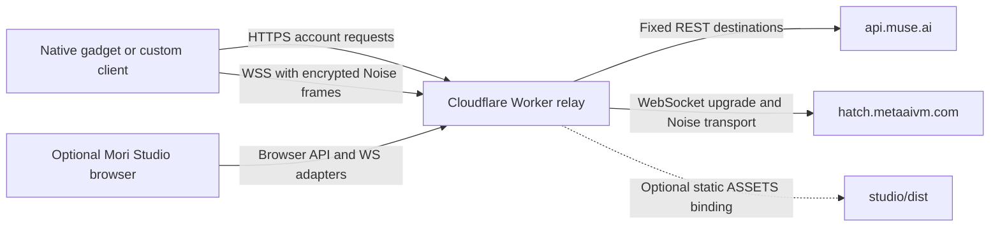
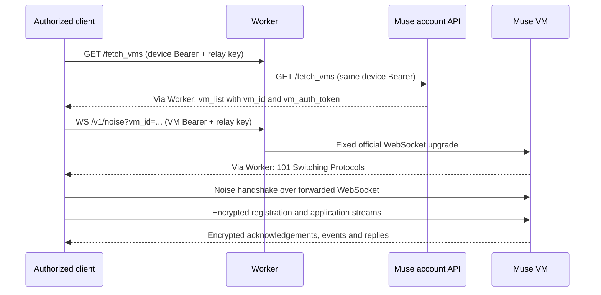

# Relay architecture

The deployable product is `relay/worker.template.mjs`. It exposes a single HTTPS/WSS origin in front of the Muse account API and Muse VM transport. Studio is one possible client of that service. A native device does not need Studio to be deployed, running or open.

## Components and boundaries

| Component | Responsibility | Does not do |
| --- | --- | --- |
| Native/browser client | Own credentials, select VM, initiate Noise, interpret application messages | Delegate Noise keys to the relay |
| Worker | Validate route/method/auth, select fixed upstream, forward requests and WS upgrades | Run an AI model, create a Muse account, decrypt Noise or store conversations |
| Official account API | Validate account/device credentials and return VM access information | Trust the relay key as a Muse credential |
| Official VM | Terminate Noise and process registered client commands/chat streams | Run inside Cloudflare |
| Optional Studio | Profile management, client-side Noise/chat protocol and rendering | Act as a required backend or provide a replacement account login |

No VPS, Python application server, database, KV or Durable Object is required by the relay. Node/pnpm/Wrangler are deployment and development tools, not a server that must remain running on your computer.

## Connection lifecycle

The last three exchanges traverse the Worker; they are shown between client and VM because those are the Noise endpoints. A 101 response alone does not prove the Noise handshake, client registration or a chat reply succeeded.

The Worker does not expose `/chat/stream` as an ordinary public REST route. Studio sends its chat request through an application stream inside the encrypted Noise WebSocket. The client implements stream framing, registration, thread creation and reply handling. Changing a URL alone does not turn an arbitrary HTTP client into a Muse chat client.

## Authentication: four different values

| Value | Supplied/issued by | Used for |
| --- | --- | --- |
| SDK token (`mgst_…`) | Gadget developer, from official SDK account | Official gadget onboarding; it is not sufficient for chat |
| Device access / refresh token | Official phone-account pairing flow | Account API access / device-token renewal |
| VM auth token | Official account API in VM information | Authenticating a Noise WebSocket for that VM |
| `MUSE_RELAY_KEY` | Relay operator | Access to this deployment's native/custom relay routes |

The operator stores only their relay key as a Cloudflare Secret. Callers provide their own Muse credentials with each request. Do not install the owner's device token as a Worker variable. Onboarding and BLE are outside this relay: it does not intercept the phone's initial account login or replace official provisioning. It can forward the implemented mint/refresh API routes when the caller already has the appropriate authorization.

## Native routes and browser adapters

Native clients use the original account paths and `/v1/noise`, plus `X-Muse-Relay-Key`. Account and Noise hosts must both point to the relay; otherwise one connection may still reach the official server directly. Preserve original request bodies, API version, refresh prefixes and Noise protocol. The extra relay key is removed before forwarding upstream.

Browsers cannot set arbitrary WebSocket Authorization headers. The adapter accepts `muse-v1` and a `muse-auth.` subprotocol containing base64url-encoded authentication JSON, converts that to the upstream Bearer header and returns only `muse-v1`. This encoding is not encryption: HTTPS/WSS protects the outer transport.

The same-site routes `/web/account`, `/web/refresh` and `/web/official-noise` do not ask for the shared relay key, but still need the caller's Muse credentials and the browser-origin policy. Custom Studio connections use `/fetch_vms`, `/device_token/refresh` and `/web/noise`, including the deployment's relay key. Cross-site Studio requires an exact `BROWSER_ORIGINS` entry.

**Relay-only means no static frontend assets.** The same Worker source still contains the browser adapter routes. Origin and `Sec-Fetch-Site` checks can be imitated by non-browser clients; they are not private API authentication. A valid Muse token is still needed, but an operator intending to restrict *all* relay usage to invited callers must add a compatible deployment-wide access policy or disable the keyless adapters. Do not publish an owner's token to make access easier.

## What “transparent” means here

- Fixed route forwarding: there is no arbitrary upstream URL, CONNECT tunnel or general internet proxy.
- REST request body bytes and upstream status/body are preserved. The Worker forwards a selected header set, adds `Cache-Control: no-store`, strips `Set-Cookie`, does not follow redirects automatically and returns 502 on an upstream fetch failure. It is not byte-for-byte HTTP-header passthrough.
- A native WebSocket upgrade passes through without reinterpreting Noise frames. Browser handshakes intentionally adapt authentication and the selected subprotocol.
- TLS ends at Cloudflare and begins again toward the official server. Cloudflare can see account authorization and REST payloads; Noise application content stays encrypted between client and Muse.
- Reconnect, keepalive, retry and conversation state belong to the client. The relay does not replay a dropped chat turn or persist an offline queue.

## Why deploy it?

Use one configurable origin for authorized Muse clients, centralize the account/WS routing, and self-host the browser authentication adapter if you want your own client. You can change domains or deployment policy without rebuilding an AI backend. This can offer a usable alternative network path when the client can reach Cloudflare and the official service accepts its egress.

There is no measured universal speedup claim. Extra hops can increase latency; the relay cannot repair a client network that cannot reach Cloudflare. Official availability, authorization and account limits remain in force.

Implementation reference: [Worker source](../relay/worker.template.mjs), [full wire contract](API.md), [Cloudflare WebSocket runtime](https://developers.cloudflare.com/workers/runtime-apis/websockets/).
