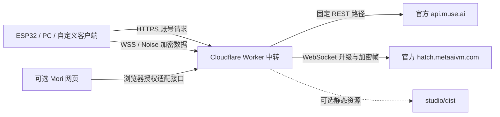

# Muse Workers Relay：用途、架构、部署与验收

这是一个可以独立部署的 Muse 中转服务。核心文件是 `relay/worker.template.mjs`。ESP32、PC 客户端和可选网页都是它的使用者；不开网页、不编译 ESP32，照样可以运行中转。

## 有什么用

把 Muse 客户端要访问的官方账号服务和 VM WebSocket 统一收敛到你自己的一个 HTTPS/WSS 域名。例如现有个人部署 `muse.2fast.cfd`：账号请求走它，Noise 长连接也走它，然后由 Worker 转到官方。

你可以自己部署、设置自己的域名和中转密钥，给经过授权的客户端使用；也可以让别人部署各自的服务。每个人仍使用自己的 Muse 账号凭证，Worker 无需保存站长的账号 Token。中转可能提供更合适的网络路径，但是否更快、能否直连，需要在目标网络实测，不能承诺全球速度一致。

## 架构



Worker 是路由和协议适配层，Muse 模型与账号服务仍在官方。外层 TLS 在 Cloudflare 终止，再向官方建立 TLS，因此 Cloudflare 能看到 HTTP 授权标头和账号请求；内层 Noise 由客户端和 Muse VM 建立，中转不持有解密密钥，不解释聊天／语音内容。

本实现无需 VPS、数据库、KV、Durable Object 或 Python 后端。Node、pnpm、Wrangler 只用于开发和部署，部署后电脑可以关机。网页构建产物仅在选择带网页版本时上传。

## 一次连接到底做了什么

1. 客户端使用自己的 device access token，请求中转的 `/fetch_vms`。
2. Worker 校验中转密钥，转发到官方账号 API；返回 VM 列表、`vm_id` 和 `vm_auth_token`。
3. 客户端使用 **VM Token** 连接中转的 `/v1/noise?vm_id=…`，Worker 向固定官方 VM 地址发起 WebSocket 升级。
4. HTTP 101 后，客户端与官方完成 Noise 握手和客户端注册。
5. 客户端在加密通道内发送应用协议请求、订阅回复、创建线程并接收消息。Worker 持续转送连接。

`/chat/stream` 等聊天应用路径在 Noise 通道内部，不是这个 Worker 公开出来的普通 HTTP 聊天 API。不能简单向域名 POST 一句文字，就当作完整 Muse 客户端。需要实现官方兼容的 Noise、注册、流和会话协议；Mori 网页就是一个已有的客户端实现。

## 四种 Token 不要混淆

| 名称 | 谁提供 | 用途 |
| --- | --- | --- |
| SDK Token，短版 `mgst_…` | 开发者从官方申请 | Gadget 配对，不能单独聊天 |
| Device access / refresh token | 手机 Muse App 官方账号配对流程 | 访问账号 API／更新设备凭证 |
| VM auth token | 官方账号 API 的 VM 信息 | 授权对应 VM 的 Noise WebSocket |
| `MUSE_RELAY_KEY` | 你自己生成 | 保护本次部署的原生／自定义中转路由 |

中转部署者只需在 Cloudflare 设置自己的中转 Secret，不应把个人 device token 放进 Worker。首次手机登录和 BLE 配对不由中转代办；mint/refresh 路径可以转发，但调用者仍须具备对应的官方授权。

## 部署方式一：只部署中转（默认）

准备 Cloudflare 账号、Node.js 22.18+、pnpm，以及有权限读取仓库的 GitHub 账号。首次从仓库根目录开始：

```sh
git clone git@github.com:tianrking/muse-workers-relay.git
cd muse-workers-relay/relay
pnpm install --frozen-lockfile
cp wrangler.example.jsonc wrangler.local.jsonc
```

PowerShell 最后一条可用 `Copy-Item wrangler.example.jsonc wrangler.local.jsonc`。已有本机配置时直接修改，不要覆盖已有域名和名称。

打开副本，修改 `name` 为自己的 Worker 名称，`main` 保持 `worker.template.mjs`。纯中转配置没有 `assets`，不需要进入 `studio/` 构建。

```sh
pnpm exec wrangler login
pnpm test
pnpm exec wrangler deploy --dry-run --config wrangler.local.jsonc
pnpm exec wrangler deploy --config wrangler.local.jsonc
pnpm exec wrangler secret put MUSE_RELAY_KEY --config wrangler.local.jsonc
```

Secret 输入提示中填写自己随机生成的长密钥，例如用 `node -e "console.log(require('node:crypto').randomBytes(32).toString('hex'))"` 生成。密钥只给自己的客户端使用，不提交到 Git，不填入普通 `vars`。它与 Muse 官方 Token 完全是两件事。

新 Worker 在 Secret 设置前统一返回 503，设置后才正常服务。`secret put` 会立即产生并部署新版本，不是只保存到本机。[Cloudflare 官方说明](https://developers.cloudflare.com/workers/configuration/secrets/)。Wrangler 输出的 workers.dev 地址即可作为服务入口，是否可达取决于客户端网络。

## 部署方式二：Cloudflare 网页直接粘贴

创建 Worker，编辑代码，把 `relay/worker.template.mjs` **完整内容**替换进去，保存部署。进入 Worker 的 Settings → Variables and Secrets，新增 **Secret** 类型的 `MUSE_RELAY_KEY`，填自己的中转密钥并保存部署。

需要外站网页调用时，再添加普通文本变量 `BROWSER_ORIGINS`，内容例如 `["https://chat.example.com"]`。这条路线部署的是纯中转；粘贴 JS 不会顺带上传 React 网页。不要拿本机忽略的旧版 `worker.js`／`worker.mjs` 分享给别人，其中可能包含旧密钥。

## 绑定自己的域名

Worker → Settings → Domains & Routes → Add → Custom Domain，填写自己 Cloudflare 活跃域名下的主机名，例如 `muse.example.com`。Cloudflare 创建对应 DNS 记录及证书；不需要 VPS IP 或手动伪造源站 A 记录。若已有冲突 CNAME，先处理冲突。[Cloudflare 自定义域名文档](https://developers.cloudflare.com/workers/configuration/routing/custom-domains/)。

绑定后用最终域名重新检查 `/health`，并把客户端账号 API 和 Noise 地址都指向它。

## 客户端具体改什么

| 项目 | 设置 |
| --- | --- |
| 账号 API 基址 | `https://你的中转域名` |
| Noise 地址 | `wss://你的中转域名/v1/noise?vm_id=官方返回的ID` |
| 中转标头 | 账号请求及原生 WS 握手都添加 `X-Muse-Relay-Key` |
| Muse 授权 | 账号请求保留 device Bearer，Noise 使用对应 VM Bearer |
| 请求内容 | 保留原始 JSON、API 版本与 refresh 授权前缀 |

不是所有官方客户端都能只改域名：它们还需要加中转密钥，并确保没有继续使用官方返回的原始 `vm_ws_url` 直连。我们适配过的 ESP32 实现在 [`test/esp32-spotpear`](https://github.com/tianrking/muse-workers-relay/tree/test/esp32-spotpear)；未经适配的 Linux SDK 不能直接宣称已经支持。

“透传”指固定路径的请求内容、响应状态和 Noise 数据保留，不是任意 HTTP 头逐字节转发：Worker 只转发选定标头，移除中转密钥和 Set-Cookie，禁止账号缓存，不自动跟随重定向，上游网络异常返回 502。浏览器 WS 握手会专门转换授权子协议。

## 怎么确认成功

| 阶段 | 成功信号 | 代表什么 |
| --- | --- | --- |
| 健康检查 | `/health` HTTP 200 | Worker 配置好且当前网络可达 |
| 账号鉴权 | `/fetch_vms` 200，有 VM 信息 | 当前设备凭证有效 |
| WebSocket | HTTP 101 | WS 升级完成 |
| 加密连接 | 客户端报告 Noise／注册成功 | 加密应用协议建立 |
| 聊天 | 新的唯一测试句收到对应回复 | 本次文字链路端到端成功 |
| 实际使用网络 | 换目标 Wi-Fi 后复测、观察重连 | 该网络上的可用性与稳定性 |

语音单独验收，不能拿文字成功代替。普通 curl 只能检查 HTTP，不能替你完成 Noise 握手和聊天协议。纯中转部署访问 `/` 没有网页是正常的：无 key 时可能 401，有 key 时未知路径 404；请测 `/health` 和实际接口。

常见错误：503 检查 Secret；`Unauthorized` 401 检查中转 key；官方 401/403 检查凭证种类、有效期和上游限制；`Origin not allowed` 检查前端 Origin；426 表示不是有效 WS Upgrade；502 表示 Worker 访问上游失败。连 HTTP 都没返回的 DNS/TLS 超时，则先查设备到 Cloudflare 的网络。

历史 PC 记录已验证账号 200、WS 101、Noise、注册、文字回复和 pong。无效凭证对照记录中的 401 一致仅说明错误透传，不代表 mint/refresh 成功；TTS 400 和 dictation 403 也没有被算作语音成功。详细证据见 [截图与验收范围](SCREENSHOTS.md)。

## 可选：加上测试聊天网页

从根目录进入 `studio/`，安装依赖并执行 `pnpm test`、`pnpm build`。在 `relay/` 使用 `wrangler.web.example.jsonc`：它与纯中转的区别是添加 `ASSETS` 静态资源绑定。已有服务只需把该 `assets` 配置合并到本机配置，保留原 Worker 名称、域名和 Secret，然后重新部署。

同一域名下 `/` 是网页，`/web/*` 是浏览器适配入口，原生 `/fetch_vms`、`/v1/noise` 等中转仍然存在。网页默认中转不需填写共享 key，但用户仍填自己的 device 凭证；自定义中转需要服务器地址、相应 key 和外站 Origin 白名单。

Origin 白名单不是账号认证，非浏览器可以伪造这些标头。**即使不部署网页，源码中的免共享 key 浏览器适配接口仍存在**；若要严格限定只有受邀客户端才能消耗中转资源，需要额外兼容的全站访问策略，或关闭这些适配入口。不能靠藏住网页或只设置 CORS 来保证私人访问。

## 截图怎么看

- [连接诊断图](../studio/docs/connection-proof.png)：当时显示中转域名、账号鉴权、Noise／注册和独立线程成功。单次 2425 ms 握手不是加速基准。
- [聊天记录图](../studio/docs/studio-chat.png)：显示独立会话和刷新后续聊的历史回包；右上角实际是“连接失败”，这是断线后保留的本地记录，不是拍图时在线。
- [首页图](../studio/docs/studio-home.png)：只展示布局，不能证明中转成功。
- [Linux 引导图](../studio/docs/linux-onboarding.png)：只验证引导界面，不证明 Linux 新配对完成。

这些是 2026-10-15 留存的历史截图，本次只完善文档，没有重新登录账号、部署线上服务或烧录固件。更多技术细节见 [英文架构](ARCHITECTURE.md) 和 [逐步部署及排障](DEPLOYMENT.md)。
