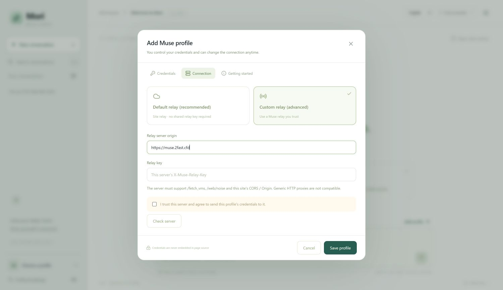
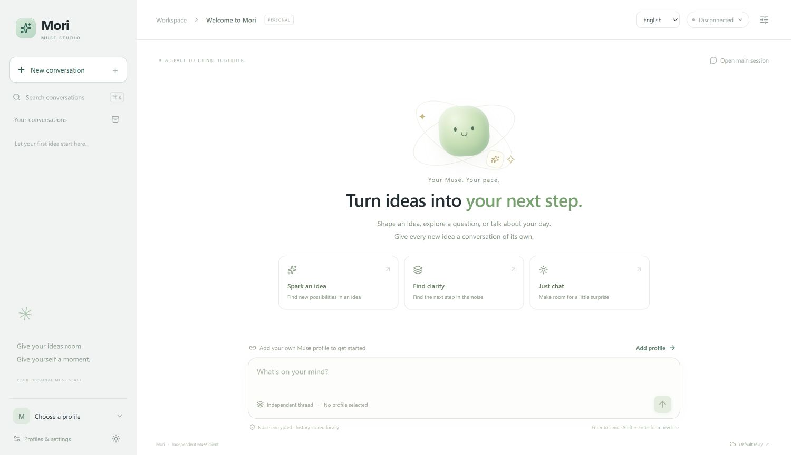

# Optional browser demo: screenshots and evidence

The product is the Worker relay. Mori Studio is an optional protocol-aware client used to exercise its browser adapters and show chat results. It is not required by native relay clients, and a relay-only deployment has no homepage.

This guide separates actual English UI verification from earlier authenticated relay tests. Screenshots contain no access token or relay secret.

## Actual English UI screenshots

The English screenshots are direct browser captures from the production build running locally on 2026-10-15, after English language support was implemented. They were not generated or translated as images. [Verification record](../studio/docs/ENGLISH-UI-VERIFICATION.md).

Shows the real custom-relay editor: a public example origin, empty key and unchecked trust box. No credentials were submitted and no authenticated connection was made.

Shows the running English UI in its disconnected state. [Diagnostics](../studio/docs/studio-diagnostics.en.jpg) truthfully show Not connected, Not measured and zero Muses. [Mobile capture](../studio/docs/studio-mobile.en.jpg) shows the responsive layout. These establish UI behavior only; they do not replace historical protocol evidence.

## Historical Chinese captures

The following original captures predate the English UI implementation. They remain in their original language as historical evidence.

## Connected diagnostics

Shows `https://muse.2fast.cfd`, one available Muse, connected status, account verification, Noise handshake/registration and an independent session. It supports the successful connection at capture time; the displayed 2425 ms is one handshake sample, not a latency benchmark or evidence of worldwide acceleration. The label “official” in older UI refers to the same-site browser adapter, not bypassing the Worker.

## Recorded chat and thread continuation

Shows the test replies “独立会话创建成功” and “刷新后继续成功。” in an independent thread. **The top-right status reads connection failed.** This screenshot was captured after the successful replies were saved locally; it does not prove an active connection at screenshot time. Actual thread acknowledgements and reply results are recorded separately in [browser-results.json](../studio/docs/browser-results.json).

## Layout preview only

[View the saved homepage](../studio/docs/studio-home.png). This illustrates profile/sidebar/thread controls and the composer. Its connection-failed badge means it is a layout example, not a transport-success screenshot.

[View Linux onboarding](../studio/docs/linux-onboarding.png). This documents the credential-source guide only; it does not prove Linux BLE pairing, browser file import or a new Linux account chat succeeded.

## Evidence levels

| Evidence | What it establishes | What it does not establish |
| --- | --- | --- |
| [Worker unit tests](../relay/worker.test.mjs) | Mocked route/auth/header/body/error and WS upgrade contracts; 16 tests | Live Cloudflare runtime or account access |
| [REST comparison snapshot](../relay/new-account-contract-results.json) | Invalid-auth requests yielded the same official/relay 401 status and body | Successful token mint/refresh |
| [PC transport snapshot](../relay/pc-preflash-relay-results.json) | Account 200, WS 101, Noise, registration, expected text reply and pong | Voice success, all networks or long-term stability |
| [Browser snapshot](../studio/docs/browser-results.json) | Recorded independent/main sessions, custom relay, thread continuation and UI checks | Two independently registered accounts or current uptime |
| [Hardware test branch](https://github.com/tianrking/muse-workers-relay/blob/test/esp32-spotpear/relay/MCU-HOTSPOT-VERIFICATION.md) | Preserved user's ordinary-hotspot connection and observed MCU status | Independent text test passed in that run; it was busy with a voice turn |

The PC JSON explicitly records TTS 400 and dictation 403; audio was not verified. Browser tests used a PC with Mihomo TUN, so they do not demonstrate direct reachability from every domestic network. Later historical UI/credential-guide updates have their own [records](../studio/docs/LINUX-ONBOARDING.zh-CN.md). The current automated suite has 13 Studio tests; earlier screenshots and JSON mention 7 because those are older test snapshots.

For a new deployment, follow [layered verification](DEPLOYMENT.md#6-verify-in-layers) and record new results with the actual client network and deployment version. Do not reuse a saved screenshot as a new live-success claim.
